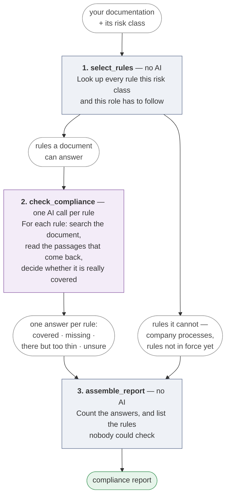

# AI Act Compliance Agent

Ingests documentation about an AI system (technical documentation, system card, or vendor
product description) and produces a structured compliance report: it classifies the system's risk
level under Regulation (EU) 2024/1689 and, for high-risk systems, checks the documentation against
provider obligations — every verdict carrying a citation to the source article.

Two jobs, in order:

1. **Classify** — what risk class is a use case? `prohibited` / `high_risk` / `not_high_risk` /
   `minimal` (or `needs_review` when the law is genuinely unsettled).
2. **Check** — for a high-risk system, does the documentation satisfy each obligation?
   `pass` / `gap` / `inadequate`. Telling a real `gap` from an `inadequate` (the requirement is
   mentioned but with no substance) is the capability this project is built and measured around.

## If you don't have documentation yet

You submit **one document**, and the agent reads what you give it — so a thin input produces a thin
report. The two jobs above ask different things of that document, and it is worth covering both.

**1. What gets you classified.** State plainly, in the Act's own terms: the **intended purpose**;
what the system does **to a person** (extracts fields? evaluates or ranks them? infers emotions?
allocates tasks?); whether you are **provider or deployer** (Art. 3(3)–(4)); and whether it
**generates content or interacts with people directly** (Art. 50). Describe *function, not benefit*,
write one section **per intended purpose** rather than per product, and say what the system does
**not** do — the Art. 6(3) derogations turn on absence. Those are the facts the cascade below
actually decides on. The Regulation does not template this part.
*(A fill-in template is planned — see M8 in `docs/ROADMAP.md`.)*

**2. What gets checked against obligations.** Here you need no guide from us, because the Act
contains one: [**Annex IV**](data/policy/annexes/2024-07-12/annex-IV.md) is its own minimum element
list for the technical documentation of a **high-risk** system — general description, development
process, monitoring and control, performance metrics, risk management, lifecycle changes, standards
applied, and a copy of the EU declaration of conformity (Art. 47, contents fixed by Annex V).
`data/golden_set/reference/` holds two complete worked examples.

Note the order: Annex IV applies *once you already know you are high-risk*, so part 2 presupposes
part 1. If you are writing from scratch and do not yet know your class, start with part 1 alone and
let the report tell you whether part 2 is owed — an Annex IV file is wasted effort on a system that
turns out not to be high-risk.

## Status

Built: the Pydantic v2 schema layer; a policy spec whose legal wording is resolved verbatim from
the Official Journal (Formex XML) with a coverage ledger over all 113 articles; a two-layer golden
set (classification + obligation-checking) with exact, generated ground truth; the LangGraph
**classification cascade**; and the LangGraph **gap-analysis graph** (both below), with local
Chroma retrieval and Langfuse tracing. Both jobs run against real models and are measured — see
`docs/ROADMAP.md` for the numbers.

The two graphs are composed — one document in, one report out:

```bash
python scripts/review.py data/golden_set/reference/hr-candidate-scoring.md
```

Not built yet: the FastAPI layer (M6).

## The review, end to end

`review()` classifies the document, then checks it against the obligations that classification
activates. It owns exactly one decision — **whether the obligation check should run at all** —
because that is a legal question rather than a property of either graph:

- **`prohibited` stops here.** Chapter III describes how a *permitted* high-risk system must be
  built and documented. Reporting documentation gaps against a banned practice would imply it may
  ship once the paperwork is fixed. It may not.
- **`needs_review` stops here** too: which obligations apply is not yet known, and findings from a
  guessed risk class are findings a provider might act on without owing them.
- **Everything else proceeds** — including `not_high_risk`, which still owes Art. 6(4): a provider
  claiming a derogation must document that assessment and register it. A "high-risk only" gate
  would look right and silently drop a real obligation.

When the check is skipped, the report says so in a `scope_note`. An empty findings list otherwise
reads as a clean bill of health, which for a prohibited practice is the most dangerous output this
tool could produce.

## How classification works

The classifier is a LangGraph cascade that mirrors the European Commission's AI Act Compliance
Checker. Each node asks one narrow, checkable question about the use case; the graph — not the
model — owns the legal routing. Prohibited practices (Art. 5) are decided *before* high-risk, and
profiling (Art. 6(3)) is a separate node evaluated *before* any derogation, because the Regulation
makes profiling high-risk *notwithstanding* the derogations.


- **The spine** (following the "keep going" answers) is the path through the checks; each solid
  branch is an exit to a risk class.
- **The flip** lives at the *"Does it score, rank or judge people?"* node. Answering *yes* exits straight to
  `high risk` — the narrow-role question is never even asked (the Art. 6(3) carve-back). Answering
  *no* drops to the narrow-role question, where a derogation exits to `not high risk`. So the
  *same* use case, with one added sentence that turns field-extraction into candidate-scoring,
  changes legal class. A CV parser that only extracts fields is `not_high_risk`; add "…and ranks
  candidates by fit" and it becomes `high_risk`. That one-sentence flip is the project's headline,
  and a keyword classifier cannot see it — both descriptions share almost all their words.
- **`needs review`** (dashed) is the abstain path: any node that answers with low confidence bails
  out here rather than guessing. For a compliance tool a confident wrong answer is the worst
  outcome, so abstaining beats guessing.

The node "brain" is injectable. A deterministic `ScriptedBrain` feeds known answers — this is what
proves the routing (and the flip) with no LLM and no API key. An `LLMBrain` (via LiteLLM) reads the
description for real; the graph around it is unchanged. Every verdict the graph emits carries a
`LegalSource`, and the assembled result is re-validated against the same schema invariants — so a
mis-wired route raises rather than emitting a wrong verdict.

See the flip for yourself, no API key required:

```bash
python scripts/classify.py --demo
```

## How gap analysis works

Given a classified system, the second graph asks whether the documentation actually satisfies each
obligation that classification activates. Same division of labour as the cascade: **code owns what
applies and what a verdict means, the model answers one bounded question at a time.**

It takes a classification as an argument rather than producing one — `review()` supplies the
cascade's output, and the two layers never import each other.

Three steps, in a line. Boxes are the three graph nodes; rounded shapes are the data passing
between them.



- **Obligations attach per use case, not per system.** A product whose CV parsing is
  `not_high_risk` and whose candidate scoring is `high_risk` owes Chapter III on the scoring use
  case alone, assessed against *that* intended purpose — so selection runs per use case and the
  results are kept apart.
- **Not everything is checkable in a document.** A quality management system, a registration in
  the EU database, a duty to cooperate — these apply, but no document can evidence them.
  They are reported as *outstanding confirmations*, never judged and never counted as gaps.
  Dropping them would read as full coverage of the Chapter III duties, which it is not.
- **The judge never decides what applies.** It reads the retrieved passages for one rule and
  answers one question. Retrieval alone cannot conclude `gap`: a vector search always returns `k`
  results, so there is no "nothing found" — only a model reading the passages can tell an absent
  requirement from a present one.
- **`gap` vs `inadequate` is decided by what the provider must DO next.** `gap` = "write this";
  `inadequate` = "strengthen this". That is the distinction the project is built and measured
  around, and word-matching cannot make it at all.
- Judgements share no state, so they run concurrently; results come back in rule order regardless
  of scheduling, because a report whose contents depended on thread timing would not be defensible.

## Development

One command runs the full gate — lint, type-check (including `ClassificationBrain` protocol
conformance),
and tests:

```bash
make check
```

Individual targets: `make lint` · `make format` · `make types` · `make test`. Tools run from the
project venv, so no activation is needed.

---

_This tool is generated by an automated system and is provided for informational purposes only.
It does not constitute legal advice, and it does not represent the assessment or official position
of the European Commission or any other authority. Its classifications and findings may be
incomplete or incorrect. Consult a qualified legal professional before relying on any part of its
output._
