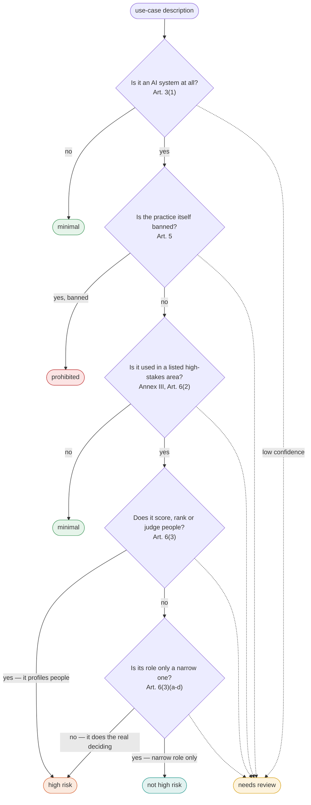

# AI Act Compliance Agent

Ingests documentation about an AI system (technical documentation, system card, or vendor
product description) and produces a structured compliance report: it classifies the system's risk
level under Regulation (EU) 2024/1689 and, for high-risk systems, checks the documentation against
provider obligations — every verdict carrying a citation to the source article.

Two jobs, in order:

1. **Classify** — what risk class is a use case? `prohibited` / `high_risk` / `not_high_risk` /
   `minimal` (or `needs_review` when the law is genuinely unsettled).
2. **Check** — for a high-risk system, does the documentation satisfy each obligation?
   `pass` / `gap` / `inadequate`. Telling a real `gap` from an `inadequate` (the requirement is
   mentioned but with no substance) is the capability this project is built and measured around.

## Status

Built: the Pydantic v2 schema layer; a policy spec whose legal wording is resolved verbatim from
the Official Journal (Formex XML) with a coverage ledger over all 113 articles; a two-layer golden
set (classification + obligation-checking) with exact, generated ground truth; and the LangGraph
**classification cascade** (below). The gap-analysis retrieval (Chroma), the real LLM run, Langfuse
tracing, and the FastAPI layer are scaffolded but not yet wired.

## How classification works

The classifier is a LangGraph cascade that mirrors the European Commission's AI Act Compliance
Checker. Each node asks one narrow, checkable question about the use case; the graph — not the
model — owns the legal routing. Prohibited practices (Art. 5) are decided *before* high-risk, and
profiling (Art. 6(3)) is a separate node evaluated *before* any derogation, because the Regulation
makes profiling high-risk *notwithstanding* the derogations.



- **The spine** (following the "keep going" answers) is the path through the checks; each solid
  branch is an exit to a risk class.
- **The flip** lives at the *"Does it score, rank or judge people?"* node. Answering *yes* exits straight to
  `high risk` — the narrow-role question is never even asked (the Art. 6(3) carve-back). Answering
  *no* drops to the narrow-role question, where a derogation exits to `not high risk`. So the
  *same* use case, with one added sentence that turns field-extraction into candidate-scoring,
  changes legal class. A CV parser that only extracts fields is `not_high_risk`; add "…and ranks
  candidates by fit" and it becomes `high_risk`. That one-sentence flip is the project's headline,
  and a keyword classifier cannot see it — both descriptions share almost all their words.
- **`needs review`** (dashed) is the abstain path: any node that answers with low confidence bails
  out here rather than guessing. For a compliance tool a confident wrong answer is the worst
  outcome, so abstaining beats guessing.

The node "brain" is injectable. A deterministic `ScriptedBrain` feeds known answers — this is what
proves the routing (and the flip) with no LLM and no API key. An `LLMBrain` (via LiteLLM) reads the
description for real; the graph around it is unchanged. Every verdict the graph emits carries a
`LegalSource`, and the assembled result is re-validated against the same schema invariants — so a
mis-wired route raises rather than emitting a wrong verdict.

See the flip for yourself, no API key required:

```bash
python scripts/classify.py --demo
```

## Development

One command runs the full gate — lint, type-check (including `ClassificationBrain` protocol
conformance),
and tests:

```bash
make check
```

Individual targets: `make lint` · `make format` · `make types` · `make test`. Tools run from the
project venv, so no activation is needed.

---

_This tool is generated by an automated system and is provided for informational purposes only.
It does not constitute legal advice, and it does not represent the assessment or official position
of the European Commission or any other authority. Its classifications and findings may be
incomplete or incorrect. Consult a qualified legal professional before relying on any part of its
output._
