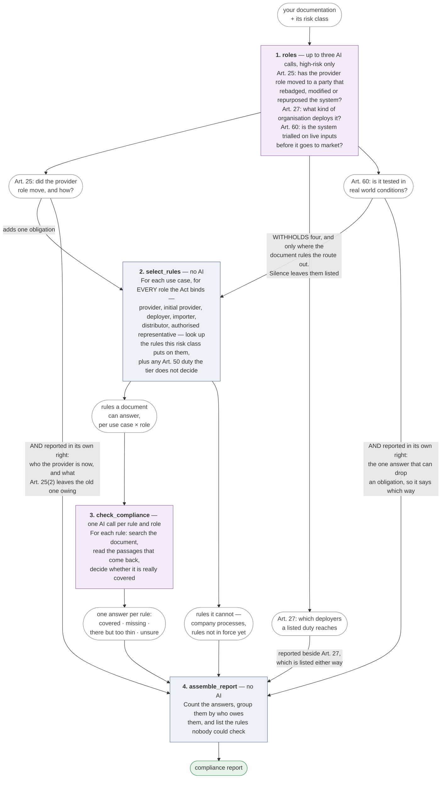

# AI Act Compliance Agent

Ingests documentation about an AI system (technical documentation, system card, or vendor
product description) and produces a structured compliance report: it classifies the system's risk
level under Regulation (EU) 2024/1689 and, for high-risk systems, checks the documentation against
the obligations it owes — for the provider and the deployer alike, every verdict carrying a
citation to the source article.

Two jobs, in order:

1. **Classify** — first, does the Regulation govern this system at all (Art. 2)? If it does, what
   risk class is the use case? `prohibited` / `high_risk` / `not_high_risk` / `minimal` — or
   `out_of_scope` where the Act is withheld, `gpai_model` where the thing described is a
   general-purpose AI model governed by Chapter V rather than by the risk tiers, and
   `needs_review` where the law is genuinely unsettled.
2. **Check** — for a high-risk system, does the documentation satisfy each obligation?
   `pass` / `gap` / `inadequate`. Telling a real `gap` from an `inadequate` (the requirement is
   mentioned but with no substance) is the capability this project is built and measured around.

## If you don't have documentation yet

You submit **one document**, and the agent reads what you give it — so a thin input produces a thin
report. The two jobs above ask different things of that document, and it is worth covering both.

**1. What gets you classified.** State plainly, in the Act's own terms: the **intended purpose**;
what the system does **to a person** (extracts fields? evaluates or ranks them? infers emotions?
allocates tasks?); whether you are **provider or deployer** (Art. 3(3)–(4)); and whether it
**generates content or interacts with people directly** (Art. 50) — and, if you deploy rather than
build it, say so, because Art. 50 splits its duties between the two roles. Say **where it is sold,
used, or its output acted on** — Art. 2(1) reaches a third-country provider whose output is used in
the Union, so "we are not a European company" settles nothing. Describe *function, not benefit*,
write one section **per intended purpose** rather than per product, and say what the system does
**not** do — the Art. 6(3) derogations turn on absence. Say too **who relies on the output**:
whether a person reviews every case regardless, or whether the system's answer settles some of them
on its own. Art. 6(3) exempts a narrow role only where it does not materially influence the
outcome, so that one fact decides the tier. Those are the facts the cascade below actually decides
on. The Regulation does not template this part.
*(A fill-in template is planned — see M8 in `docs/ROADMAP.md`.)*

**2. What gets checked against obligations.** Here you need no guide from us, because the Act
contains one: [**Annex IV**](data/policy/annexes/2026-07-27/annex-IV.md) is its own minimum element
list for the technical documentation of a **high-risk** system — general description, development
process, monitoring and control, performance metrics, risk management, lifecycle changes, standards
applied, and a copy of the EU declaration of conformity (Art. 47, contents fixed by Annex V).
`data/golden_set/reference/` holds two complete worked examples.

Note the order: Annex IV applies *once you already know you are high-risk*, so part 2 presupposes
part 1. If you are writing from scratch and do not yet know your class, start with part 1 alone and
let the report tell you whether part 2 is owed — an Annex IV file is wasted effort on a system that
turns out not to be high-risk.

## Status

Built: the Pydantic v2 schema layer; a policy spec whose legal wording is resolved verbatim from
the Official Journal (Formex XML) with a coverage ledger over every one of the 789 provisions of
the consolidated Act — 79 rules, and nothing owed and unreported; a two-layer golden
set (classification + obligation-checking) with exact, generated ground truth; the LangGraph
**classification cascade**; and the LangGraph **gap-analysis graph** (both below), with local
Chroma retrieval and Langfuse tracing. Both jobs run against real models and are measured — see
`docs/ROADMAP.md` for the numbers.

The two graphs are composed — one document in, one report out:

```bash
python scripts/review.py data/golden_set/reference/hr-candidate-scoring.md
```

The same review as a web page — paste a document, read the report — is the **report app**:

```bash
make app        # http://127.0.0.1:8766, model and key from .env
```

**Load a file** accepts Markdown and plain text, and also PDF and Word (`.docx`): the server
extracts their text (`POST /api/extract` — no model call, nothing stored) into the input box, so
what the review reads is on screen before it runs. A scanned PDF holds no text and is refused with
a message; it needs OCR first.

**Print** and **Download** are one pair of small buttons with three stops: docked at the report's
head beside the system's name, in a row fixed to the bottom of the window while reading (beside
the demo label in demo mode), and docked again at the report's end — one pair on screen at a time.
The row fits one line on any screen: on a phone the demo label shortens to "Demo" and a ✕, and
below 360px the floating pair keeps only its icons.

**Download** saves the report on screen as a Markdown file. The file holds the classification, the
verdict, every checked duty with its evidence and criteria, the checklist as a task list ticked the
way the reader ticked it, the other provisions and the disclaimer — the whole report whatever the
page's filters show, and a demo report stays marked as one. The Act's own wording behind each row
is left out; each row keeps its citation. The file is written in the browser
(`static/report-md.js`), because the ticks and the verdict they decide exist only there.

**Print** prints the same content, or saves it as a PDF named like the Markdown file. Paper also
holds the whole report whatever the filters show: every row opened, the verdict for every role, the
checklist as ticked, and the time of printing. The Act's own wording is left out. The page is set
up on the browser's print events, so Ctrl/Cmd+P prints the same thing, and put back as it was
afterwards. The paper layout is the light theme whatever the page shows (`@media print` in
`static/report.css`), and its margins hold the page number alone: in Chrome and Edge the browser's
own header and footer (date, title, URL) are replaced even with "Headers and footers" ticked;
Firefox and Safari leave them to that checkbox. A high-risk report with every duty listed runs to about ninety A4 pages.

## The report app's two modes

The page runs in one of two modes, and says which in the bar, in a banner, in a label fixed to the
window and in its colours — orange for a real review, violet for the demo.

- **Normal mode** is the review: paste a document, every model seam live, a minute or two per
  document, the model named in `AIACT_LLM_MODEL` with its key in `.env`.
- **Demo mode** is the same pipeline with the three model seams — the classification brain, the
  judge and the summariser — replaced by deterministic keyword heuristics
  (`src/aiact/report_app/demo.py`). No key, no cost, under a second, and the real report: the real
  cascade and its legal routing, the real rule selection, the real page. What changes is who
  answers the questions, and a demo report says so at its top, beside its title and on every verdict
  — the response carries `demo: true`, and every heuristic answer starts with `Demo:`. **A demo
  report is illustrative.** Word-matching cannot tell a `gap` from an `inadequate` — that is the
  claim this project is built and measured around — so the demo shows what a report looks like and
  how it reads, never whether a system complies.

**Demo mode has no free text input: its documents are the cases.** The page opens on a gallery
of twelve cards, each marked with the outcome the demo reaches on that document, and one click runs
it — the reviewed document can be shown read-only beside the report. The cases are registered in
`data/demo/samples.yaml` and served by `GET /api/samples`: the golden set's reference files
(`data/golden_set/reference/` — high-risk, every checked duty met), the worked-example card from
[the system-card guide](docs/system-card-guide.md) (high-risk, Arts. 9–15 as gaps), the smoke
check's anonymised vendor pages (`data/golden_set/smoke/` — one prohibited, one not high-risk, one
high-risk with nothing to check), and six cards written for the demo under `data/demo/cards/` for
the cases the golden set does not cover: an Annex I medical device assessed by a notified body
(high-risk under Art. 6(1), a partly written file), an Annex I lift component whose card never says
who assesses conformity (needs review), CV extraction with its Art. 6(4) assessment written down
(not high-risk), a retail chatbot owing Art. 50(1) and 50(2) (minimal risk), a general-purpose
model card (Chapter V), and an exclusively military system (outside the Act). A reader's own
document belongs in a real review. Normal mode offers no samples: a complete system card is far
more than any of these cases, and the way to write one is [the guide](docs/system-card-guide.md) —
a stock document in a real review would read as a template of one. A demo report lives in the page's
memory, not in the browser's storage: it survives a mode switch, not a reload — a sample is one
click away again.

**Which mode the page offers** is decided by the server, and `GET /api/mode` tells the page why:

- A live review is offered only where one can run: `AIACT_LLM_MODEL` names a model **and** a key
  for its provider is set (the variables LiteLLM reads for Anthropic, OpenAI, Gemini and Mistral
  are recognised), or a LiteLLM proxy is set, which holds its own. A provider the page does not
  know is given the benefit of the doubt. Otherwise the page runs in demo mode alone, the switch
  locked on and the banner saying — provider-agnostically — that no key is set, and
  `POST /api/review` answers 503 rather than failing on the first call.
- `AIACT_DEMO_MODE` (`.env`) sets the rest: `available` (the default) offers both; `only` switches
  live reviews off — a public showcase; `off` removes the demo, and `POST /api/demo/review`
  answers 403.

**Bring your own key.** A reader can run a live review on their own provider account: the key goes
in the `X-LLM-API-Key` header of `POST /api/review` and the model, optionally, in the body
(`model`, any LiteLLM model string; `GET /api/models` lists the ones this project has priced and
shaped a request for). The review's three model seams — the classification brain, the judge and
the summariser — all run on that key and that model, for that request only; the key is never
stored, logged, traced or indexed (see `SECURITY.md`), and the response names the model that wrote
the report. `AIACT_BYOK_MODE` decides what the server does with a key: `available` (the default)
honours one where sent and uses its own otherwise; `required` never spends the server's keys on a
review — a public deployment; `off` refuses the header, so a document goes only to the provider the
operator configured. `GET /api/mode` reports the setting in `byok`, with whether a key or a model
must come with the request. On the page, the two fields sit under the document in normal mode —
the model with a list of the priced ones to pick from, the key in a password field that is never
shown, never saved and empty again after a reload — and say, beside them, which of the two this
server needs. Demo mode has neither: it calls no model.

## The review, end to end

`review()` classifies the document, then checks it against the obligations that classification
activates. It owns exactly one decision — **whether the obligation check should run at all** —
because that is a legal question rather than a property of either graph:

- **`out_of_scope` stops here**, and owes nothing: there are no obligations to check against, so
  running the check would produce findings for duties that do not exist.
- **`prohibited` gets Chapter III from nobody, and Art. 5's own conditions where they exist.**
  Chapter III describes how a *permitted* high-risk system must be built and documented, and
  reporting gaps against it would imply a banned practice ships once the paperwork is fixed. It may
  not, and no Chapter III rule names this tier. **One prohibition has a lawful branch**, though:
  Art. 5(1)(h) bans real-time remote biometric identification for law enforcement *"unless and in so
  far as such use is strictly necessary"* for the objectives it lists, and Art. 5(5) lets a Member
  State authorise that use. A deployer there owes Art. 5(2), (3) and (4) — a fundamental rights
  impact assessment, an EU database registration, prior judicial authorisation per use, a 24-hour
  clock on the urgency route, deletion of everything if the authorisation is refused, and a
  notification of each use to two authorities. Those three rules name the practice, so a system
  banned for social scoring still reaches an empty findings list. The verdict and the note are
  unchanged either way: the practice is prohibited, and this is what Art. 5 costs the deployer that
  holds the authorisation.
- **`gpai_model` proceeds, onto a different track.** Chapter V governs a general-purpose AI model,
  and the ruleset carries it: sixteen `AIA-RULE-GP-*` rules for Arts. 52 to 55, selected by the tier
  alone, so a model gets Chapter V and none of Arts. 9–15. **None of them is judged**, and the
  `scope_note` says so — the two gates that decide who owes what in Chapter V are read from the same
  model card a judge would read, so a card that understates its compute or overstates its licence
  would otherwise clear four duties at once.
- **`needs_review` stops here** too: which obligations apply is not yet known, and findings from a
  guessed risk class are findings a provider might act on without owing them.
- **Everything else proceeds** — including `not_high_risk`, which still owes Art. 6(4): a provider
  claiming a derogation must document that assessment and register it. A "high-risk only" gate
  would look right and silently drop a real obligation.

When the check is skipped, the report says so in a `scope_note`. An empty findings list otherwise
reads as a clean bill of health, which for a prohibited practice is the most dangerous output this
tool could produce.

## How classification works

The classifier is a LangGraph cascade that mirrors the European Commission's AI Act Compliance
Checker. Each node asks one narrow, checkable question about the use case; the graph — not the
model — owns the legal routing. Order is itself legal reasoning: whether the Act applies at all
(Art. 2) is settled *before* the ban check, prohibited practices (Art. 5) *before* high-risk, and
profiling (Art. 6(3)) is a separate node evaluated *before* any derogation, because the Regulation
makes profiling high-risk *notwithstanding* the derogations.

```mermaid
flowchart TD
    START([use-case description]) --> is_ai{"Is it an AI system at all?<br/>Art. 3(1)"}
    is_ai -->|no| MIN1([minimal]):::ok
    is_ai -->|yes| territorial{"Is it sold, used, or its output<br/>relied on in the EU?<br/>Art. 2(1)"}
    territorial -->|"no — it is placed, used and<br/>consumed entirely outside the EU"| OOS
    territorial -->|"yes, or the document<br/>never says"| scope{"Does this law apply to the system at all?<br/>Art. 2(3)-(12)"}
    scope -->|"no — military, research-only,<br/>pre-market, or a person's own use"| OOS([out of scope]):::oos
    scope -->|yes| gpai_model{"Is this a general-purpose MODEL,<br/>or a system?<br/>Art. 3(63)"}
    gpai_model -->|"a model — placed, or not yet"| systemic_risk{"Does the card STATE systemic risk?<br/>a designation, or compute over 10^25<br/>Art. 51(1), Art. 51(2)"}
    systemic_risk --> gpai_open_source_release{"Does it STATE a free and open-source<br/>release with public weights?<br/>Art. 53(2), Art. 54(6)"}
    gpai_open_source_release --> GP([general-purpose AI model<br/>Chapter V obligations, listed not judged]):::gpai
    gpai_model -->|"a system, incl. one built<br/>on such a model"| prohibited{"Is the practice itself banned?<br/>Art. 5(1)(a)-(h)"}
    prohibited -->|"yes — a named point bans it"| BAN([prohibited]):::ban
    prohibited -->|no| annex_i{"Is it a safety part of a regulated<br/>physical product?<br/>Annex I, Art. 6(1)(a)"}
    annex_i -->|yes| third_party_assessment{"Does that product need an<br/>outside body to certify it?<br/>Art. 6(1)(b)"}
    third_party_assessment -->|yes| HIGH([high risk]):::high
    third_party_assessment -->|"no — self-certified"| annex_iii
    annex_i -->|no| annex_iii{"Is it used in a listed high-risk area?<br/>Annex III, Art. 6(2)"}
    annex_iii -->|no| MIN2([minimal]):::ok
    annex_iii -->|yes| profiling{"Does it score, rank or judge people?<br/>Art. 6(3)"}
    profiling -->|"yes — it profiles people"| HIGH
    profiling -->|no| derogation{"Is its role only a narrow one?<br/>Art. 6(3)(a-d)"}
    derogation -->|"no — none of (a)-(d) fits"| HIGH
    derogation -->|"yes — narrow role only"| significant_risk{"Could it still materially affect<br/>the decision?<br/>Art. 6(3), first subparagraph"}
    significant_risk -->|"yes — it does the real deciding"| HIGH
    significant_risk -->|"no — a person decides anyway"| NHR([not high risk]):::mid
    is_ai -.->|low confidence| NR([needs review]):::rev
    territorial -.-> NR
    scope -.-> NR
    gpai_model -.-> NR
    prohibited -.-> NR
    annex_i -.-> NR
    third_party_assessment -.-> NR
    annex_iii -.-> NR
    profiling -.-> NR
    derogation -.-> NR
    significant_risk -.-> NR

    classDef gpai fill:#efeaf7,stroke:#7a63a8
    classDef oos fill:#eceef1,stroke:#7a828c
    classDef ban fill:#fbe4e4,stroke:#c23b3b
    classDef high fill:#fbeadf,stroke:#d9683a
    classDef mid fill:#e2f2f0,stroke:#2f9e93
    classDef ok fill:#e6f4ea,stroke:#4a9d63
    classDef rev fill:#fdf3de,stroke:#d9a521
```



- **Scope is two questions, not one.** Art. 2(1) is the *positive* limb — does the Regulation
  reach this actor at all: a system placed on the EU market, an EU deployer, or a third-country
  provider whose **output is used in the Union**. "We're a US company" answers none of that. Only
  a document that positively rules out every limb takes a system out here; almost no document
  mentions territory, so silence continues the assessment rather than stopping it. A system Art.
  2(1) never reached is not *excluded* — nothing was carved out — so its citation says 2(1) rather
  than borrowing an exclusion's paragraph.
- **Then the exclusions.** Art. 2(3)–(12) withhold the Regulation from
  systems used only for military or defence purposes, built only to do science, still in
  development before sale, or used by a private person in their own life. This is asked *before*
  the ban check, because Art. 5 is part of this Regulation and cannot reach a system it does not
  govern. **`out of scope` is not a low risk class**: a `minimal` system is inside the Act and
  still owes Art. 4 AI literacy, while an excluded one owes nothing at all. Every exclusion is
  written narrowly — *exclusively* military, *sole* purpose of research, *purely* personal — so
  buying under defence procurement rules, holding a research grant, or selling to consumers does
  not by itself get you out. One exclusion is left open at this point and settled at the end: a
  free and open-source release (Art. 2(12)) is excluded *unless* it turns out high-risk, banned,
  or subject to Art. 50, which are exactly the questions the rest of the cascade answers.
- **A general-purpose model is not on this track at all.** Art. 6 classifies AI *systems*. A
  **general-purpose AI model** (Art. 3(63) — significant generality, a wide range of distinct tasks,
  integrable downstream) has no risk tier: Chapter V governs it, and its provider owes Art. 53
  documentation, downstream information, a copyright policy and a public training-data summary —
  plus Art. 55 where the model carries systemic risk. **Those duties have applied since 2 August
  2025**, earlier than every high-risk obligation this tool checks. The report lists all of them,
  rule by rule. The guard matters as much: Art. 3(66) makes a system *built on* such a model an
  ordinary AI system, so an LLM-backed hiring tool is still Annex III(4) high-risk. The question
  tests **generality**, not size — a single-purpose pre-trained model is not GPAI however large.
- **Chapter V's two gates are asked, and neither is allowed to clear anything.** Art. 51 decides
  whether the model carries **systemic risk**, which turns the whole of Art. 55 on; Arts. 53(2) and
  54(6) decide whether a **free and open-source release** turns Art. 53(1)(a)–(b) and all of Art. 54
  off. Both nodes read a **stated claim** and answer `not_stated` otherwise: a designation or an
  Art. 52(1) notification settles the first, a stated training-compute figure settles it against
  Art. 51(2)'s 10²⁵ threshold, and estimating FLOP from a parameter count is refused. Neither answer
  withholds an obligation — every Chapter V rule is selected for every model, and what the answers
  produce is a note telling the reader **which side of each line their own document falls on**. The
  two are written together, because a fully open release lifts nothing while the model carries
  systemic risk, and a note composed from the licence alone would tell a systemic-risk provider that
  Art. 54 had fallen away.
- **A model still in development gets a deadline, not a clearance.** Art. 3(63) excludes models in
  research or prototyping until they are placed on the market, and Art. 2(8) excludes the
  development activity itself. Both are *temporal*. So the cascade does not stop at the exclusion:
  Art. 2(8) falls through to the Art. 3(63) question, and a pre-market general-purpose model is
  reported **as a model**, with Arts. 53 and 55 listed in full and the note that they attach the day
  it ships — with no transition period, since Chapter V has applied since August 2025. Reporting
  "outside scope, nothing owed" would be true this morning and misleading by the time anyone acted
  on it.
- **A ban must name the point that bans it.** Art. 5(1) prohibits ten specific practices, and
  the node answers *which* — not merely *whether*. This is the only class that tells a provider
  their system may not ship at all, and "Art. 5" alone gives them nothing to check the claim
  against. Naming the point also forces the exception into view: (d) does not reach a system
  supporting a human assessment already grounded in objective facts, (f) not medical or safety
  uses, (g) not the labelling of lawfully acquired datasets, and (h) is lifted for three named
  law-enforcement objectives. The two points the 2026 Omnibus inserted, (ba) and (bb), turn on
  safeguards rather than capability — a generator is not banned for being *able* to produce the
  material — and they are the first points of the Article with an application date of their own,
  so the report says when a ban bites rather than assuming it already has. A verdict that cannot
  cite its point is reported as `needs review`, never as a ban and never as a clearance.
- **Two doors into high risk, not one.** Art. 6(1) catches AI *inside a regulated physical
  product* — a braking controller, a dose limiter in a surgical robot. Art. 6(2) catches AI used
  *for a listed purpose* — hiring, credit, policing. A surgical robot appears nowhere in Annex III,
  so a cascade that asks only the second question tells it that it owes nothing. Art. 6(1) also
  needs **both** its conditions: failing the certification test is not an exit, because a
  self-certified product can still be high-risk by the other door.
- **Escaping high risk also takes two answers, not one.** Art. 6(3) exempts a listed system only
  where its role is narrow *and* it poses no significant risk of harm — "including by not
  materially influencing the outcome of decision making". Both, or neither. A screening step that
  applies one fixed rule has a narrow role by any reading, but if it auto-rejects people who then
  never reach a human, it decides the outcome and stays `high risk`. So the cascade asks the narrow
  role first (nothing else matters without it) and then asks who actually relies on the output.
- **The spine** (following the "keep going" answers) is the path through the checks; each solid
  branch is an exit to a risk class.
- **The flip** lives at the *"Does it score, rank or judge people?"* node. Answering *yes* exits straight to
  `high risk` — the narrow-role question is never even asked (the Art. 6(3) carve-back). Answering
  *no* drops to the narrow-role question, where a derogation that clears both limbs exits to
  `not high risk`. So the
  *same* use case, with one added sentence that turns field-extraction into candidate-scoring,
  changes legal class. A CV parser that only extracts fields is `not_high_risk`; add "…and ranks
  candidates by fit" and it becomes `high_risk`. That one-sentence flip is the project's headline,
  and a keyword classifier cannot see it — both descriptions share almost all their words.
- **Art. 50 runs beside the tier, not inside it,** and it answers with a LIST. The five duties are
  cumulative — an avatar that chats and generates video owes 50(1), 50(2) and 50(4) at once — and
  they split by role: **(1) and (2) bind the provider**, **(3) and (4) bind the deployer**. They are
  different duties, owed by different parties, discharged in different documents, so the report
  groups them by who owes them rather than listing "Art. 50 applies". A minimal-risk generator and
  a high-risk chatbot can both owe them, and a high-risk system may owe none — which is why this
  question is asked on every path and never routes anything. The duty is then CHECKED like any
  other: the gap layer carries four Art. 50 rules, and they are the only ones that activate on a
  duty rather than on a risk class, because no set of tiers describes when Art. 50 applies.
- **`needs review`** (dashed) is the abstain path: any node **on the risk path** that answers with
  low confidence bails out here rather than guessing. For a compliance tool a confident wrong answer
  is the worst outcome, so abstaining beats guessing. The two Chapter V gates have no dashed edge
  and that is deliberate — they decide which obligations a model owes, not whether the thing is a
  model, and dragging a settled classification to `needs review` over a question it did not turn on
  would report the wrong uncertainty. `transparency` is off this path for the same reason.

The node "brain" is injectable. A deterministic `ScriptedBrain` feeds known answers — this is what
proves the routing (and the flip) with no LLM and no API key. An `LLMBrain` (via LiteLLM) reads the
description for real; the graph around it is unchanged. Every verdict the graph emits carries a
`LegalSource`, and the assembled result is re-validated against the same schema invariants — so a
mis-wired route raises rather than emitting a wrong verdict.

See the flip for yourself, no API key required:

```bash
python scripts/classify.py --demo
```

## How gap analysis works

Given a classified system, the second graph asks whether the documentation actually satisfies each
obligation that classification activates. Same division of labour as the cascade: **code owns what
applies and what a verdict means, the model answers one bounded question at a time.**

It takes a classification as an argument rather than producing one — `review()` supplies the
cascade's output, and the two layers never import each other.

Four nodes. Boxes are the nodes; rounded shapes are the data passing between them, and the edges out
of the two role answers are labelled because they do different things. **Neither ever removes an
obligation** — that is the invariant the whole layer is built on.



- **Obligations attach per use case, not per system.** A product whose CV parsing is
  `not_high_risk` and whose candidate scoring is `high_risk` owes Chapter III on the scoring use
  case alone, assessed against *that* intended purpose — so selection runs per use case and the
  results are kept apart.
- **And some of them attach per *area*, which is the difference between a citation and the right
  citation.** Art. 43 does not say one thing about conformity assessment: an Annex III point 1
  (biometrics) system may need a **notified body** (43(1)), points 2 to 8 self-assess under
  Annex VI (43(2)), and an Annex I product follows its **own sectoral act** instead (43(3)). Three
  mutually exclusive branches, so a rule carries `applies_to_annex_iii_area` and `applies_to_route`
  beside risk class and role. Both default to *no condition*, because most obligations — Arts. 9–15,
  16–21 — genuinely bind every high-risk system alike. A test asserts every high-risk system owes
  exactly one Art. 43 rule: two would be contradictory law, none reads in a report as *no conformity
  assessment required*.
- **And per role, not per organisation.** The Regulation attaches duties to the ROLE, and the
  report covers **every role it binds** — provider (Chapter III, Arts. 16–21), deployer
  (Arts. 26–27 and 86), authorised representative (Art. 22), importer (Art. 23), distributor
  (Art. 24),
  with **Art. 4 (AI literacy) binding provider and deployer alike**. One organisation may hold
  several roles and is assessed separately for each. Selection runs once per *(use case, role)*
  pair, every finding records whose duty it is, and the report is grouped by duty-holder — a
  provider cannot confirm that a deployer informed its workers under Art. 26(7), and a flat list
  invites them to try. There is no switch to narrow it: reporting one role's half is not a narrower
  report, it is a misleading one.
- **No role can go missing.** The covered roles are derived from the ruleset, never listed by
  hand, and the coverage ledger partitions `ActorRole` the same way it partitions the articles:
  a role either has rules or is listed with a reason, and a test enforces it. So a role added to
  the enum, or one that loses its last rule, fails CI rather than quietly disappearing from every
  report — an omitted role reads as a role that owes nothing, and no role the Act names owes
  nothing. One is listed out, and not by oversight: the **product manufacturer**. Art. 25(3) gives
  it no duty set of its own — it makes it *the provider*, owing Art. 16 whole — so writing rules for
  it would state as a separate obligation set the very thing the Article says is the provider's. It
  is reached by the Art. 25 step below instead, which answers with the provider ruleset this spec
  already holds.
- **A role that changes hands leaves a duty behind.** Art. 25(2) says the party that originally
  placed the system "shall no longer be considered to be a provider of that specific AI system" —
  and then binds it anyway: cooperate with the new provider, supply the information, technical
  access and assistance needed for the conformity assessment. So `ActorRole` names an **initial
  provider**, holding exactly that one rule and holding it only where a reallocation actually
  occurred. It is a role of its own because the duty runs the wrong way to sit anywhere else:
  attaching it to `provider` would put it on the organisation that has just taken the role ON.
  This is one of two places where a question rather than the classification decides whether a rule
  activates at all, which is why the Art. 25 answer feeds `select_rules`. Art. 60 below is the
  other, and the two default opposite ways.
- **And the roles can change hands, which is the first thing this graph asks.** Where the system is
  high-risk, Art. 25 makes a distributor, importer or deployer **the provider** — owing Art. 16
  whole, not a share of it — if it puts its name on a high-risk system someone else placed on the
  market, substantially modifies one (Art. 3(23): outside the supplier's conformity assessment, not
  merely "customised"), or changes the intended purpose of an ordinary system so that it becomes
  high-risk. Art. 25(3) does the same to a product manufacturer shipping bought-in AI inside its own
  product. A company that white-labels a vendor's hiring tool reads a report listing the provider's
  duties beside the deployer's, assumes the short column is theirs, and is wrong about both.
  Art. 25(2) is the half worth acting on: the party you bought from stops being the provider and
  owes you the information and technical access to do the conformity assessment.
  This is a question about the READER, not the system, which is why it is here and not in the
  cascade — it consumes the risk class and changes nothing about it. Asked only at high risk,
  because that is the only system Art. 25 reallocates the provider of.
- **Some duties bind only part of a role, and the report says so beside them — it does not
  withhold them.** Art. 27's fundamental rights impact assessment reaches deployers that are bodies
  governed by public law or private entities providing public services, and deployers of Annex
  III(5)(b)–(c) systems — not deployers at large. Neither limb is a fact about the system, so no
  technical file settles it and this tool does not guess: the rule carries an `activation_condition`
  in plain words, and it is listed under the deployer's obligations like any other. Demoting it into
  a "might not apply to you" list would be the tool deciding on a reader's behalf which of their
  duties to take seriously, which is the same error as omitting a role because no ruleset was
  written for it. But where the documentation *does* answer the condition — "deployed by the
  municipality of X", "sold to private recruiters" — the report says which side it falls on rather
  than restating the condition and ignoring the answer. Three outcomes, and the third is not the
  second: **reached**, **not reached on that limb**, and **the document does not say**. Reading
  silence as "commercial, so nothing owed" would clear a duty on evidence nobody supplied.
- **An elective route carries duties nobody else owes, and silence is not a clearance.** A provider
  may test a high-risk system **in real world conditions** outside a sandbox before placing it on
  the market (Art. 60), and doing so costs eleven conditions that all bind *before* the first live
  input — a testing plan submitted to and approved by the market surveillance authority, a
  registration by one of three routes that differ in where the entry goes and what it holds, a
  six-month ceiling, a written agreement
  with any participating deployer — plus serious-incident reporting with a standing recall
  procedure (60(7)), notification of the outcomes (60(8)), and informed consent from every subject
  (Art. 61). A provider that never leaves the lab owes none of it, so the question is asked.
  **It defaults the opposite way to Art. 25**, and the difference is what the silence is about.
  A reallocation nobody established did not happen, and asserting Art. 25(2) anyway would invent a
  party. Here the party plainly exists — this system's provider — and what is unknown is whether
  they are running a trial, which a technical file has no reason to mention either way. So only a
  document that *positively* rules the route out withholds these duties; silence lists them with
  their condition attached. It is the one answer in the report that can remove an obligation, and
  the report says which way it went rather than letting four rules appear and disappear in silence.
- **`minimal` is not `out_of_scope`, and Art. 4 is what proves it.** A minimal-risk system is
  inside the Regulation: both its provider and its deployer owe AI literacy measures, in force
  since 2 February 2025. An excluded system owes nothing at all. If the obligation layer returned
  an empty set for both, the distinction the classifier works so hard to draw would vanish at the
  last step.
- **Not everything is checkable in a document.** A quality management system, a registration in
  the EU database, a duty to cooperate — these apply, but no document can evidence them.
  They are reported as *outstanding confirmations*, never judged and never counted as gaps.
  Dropping them would read as full coverage of the Chapter III duties, which it is not.
- **The judge never decides what applies.** It reads the retrieved passages for one rule and
  answers one question. Retrieval alone cannot conclude `gap`: a vector search always returns `k`
  results, so there is no "nothing found" — only a model reading the passages can tell an absent
  requirement from a present one.
- **`gap` vs `inadequate` is decided by what the provider must DO next.** `gap` = "write this";
  `inadequate` = "strengthen this". That is the distinction the project is built and measured
  around, and word-matching cannot make it at all.
- Judgements share no state, so they run concurrently; results come back in rule order regardless
  of scheduling, because a report whose contents depended on thread timing would not be defensible.

## Development

One command runs the full gate — lint, type-check (including `Brain` protocol
conformance),
and tests:

```bash
make check
```

Individual targets: `make lint` · `make format` · `make types` · `make test`. Tools run from the
project venv, so no activation is needed.

## License

The code is released under the [MIT License](LICENSE).

The MIT License does not cover the official EU texts kept in `data/policy/`: the text of Regulation
(EU) 2024/1689 taken from EUR-Lex, and the European Commission guidelines in
`data/policy/guidance/`. These are © European Union and are reused under Commission Decision
2011/833/EU on the reuse of Commission documents. Only the official texts published in the
Official Journal of the European Union are authentic.

---

_This tool is generated by an automated system and is provided for informational purposes only.
It does not constitute legal advice, and it does not represent the assessment or official position
of the European Commission or any other authority. Its classifications and findings may be
incomplete or incorrect. Consult a qualified legal professional before relying on any part of its
output._

_Some questions the Regulation asks cannot be answered from the Regulation alone. Where an AI system
is part of a regulated product — a medical device, machinery, a vehicle, and the other categories
listed in Annex I — its risk class depends on rules in that product's own legislation, which this
tool does not apply. Those questions need a specialist in that sector, not only a lawyer. This tool
does not attempt them: it reports what the documentation states, says when the answer is missing,
and leaves the question open rather than guessing. **An open question is unfinished work, not a
clean result.**_
