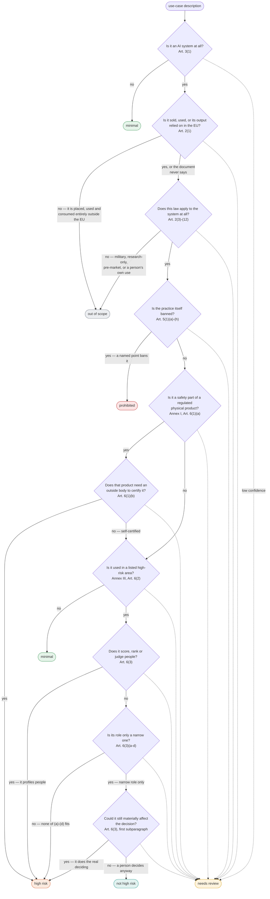

# AI Act Compliance Agent

Ingests documentation about an AI system (technical documentation, system card, or vendor
product description) and produces a structured compliance report: it classifies the system's risk
level under Regulation (EU) 2024/1689 and, for high-risk systems, checks the documentation against
the obligations it owes — for the provider and the deployer alike, every verdict carrying a
citation to the source article.

Two jobs, in order:

1. **Classify** — first, does the Regulation govern this system at all (Art. 2)? If it does, what
   risk class is the use case? `prohibited` / `high_risk` / `not_high_risk` / `minimal` — or
   `out_of_scope` where the Act is withheld, and `needs_review` where the law is genuinely
   unsettled.
2. **Check** — for a high-risk system, does the documentation satisfy each obligation?
   `pass` / `gap` / `inadequate`. Telling a real `gap` from an `inadequate` (the requirement is
   mentioned but with no substance) is the capability this project is built and measured around.

## If you don't have documentation yet

You submit **one document**, and the agent reads what you give it — so a thin input produces a thin
report. The two jobs above ask different things of that document, and it is worth covering both.

**1. What gets you classified.** State plainly, in the Act's own terms: the **intended purpose**;
what the system does **to a person** (extracts fields? evaluates or ranks them? infers emotions?
allocates tasks?); whether you are **provider or deployer** (Art. 3(3)–(4)); and whether it
**generates content or interacts with people directly** (Art. 50) — and, if you deploy rather than
build it, say so, because Art. 50 splits its duties between the two roles. Say **where it is sold,
used, or its output acted on** — Art. 2(1) reaches a third-country provider whose output is used in
the Union, so "we are not a European company" settles nothing. Describe *function, not benefit*,
write one section **per intended purpose** rather than per product, and say what the system does
**not** do — the Art. 6(3) derogations turn on absence. Say too **who relies on the output**:
whether a person reviews every case regardless, or whether the system's answer settles some of them
on its own. Art. 6(3) exempts a narrow role only where it does not materially influence the
outcome, so that one fact decides the tier. Those are the facts the cascade below actually decides
on. The Regulation does not template this part.
*(A fill-in template is planned — see M8 in `docs/ROADMAP.md`.)*

**2. What gets checked against obligations.** Here you need no guide from us, because the Act
contains one: [**Annex IV**](data/policy/annexes/2024-07-12/annex-IV.md) is its own minimum element
list for the technical documentation of a **high-risk** system — general description, development
process, monitoring and control, performance metrics, risk management, lifecycle changes, standards
applied, and a copy of the EU declaration of conformity (Art. 47, contents fixed by Annex V).
`data/golden_set/reference/` holds two complete worked examples.

Note the order: Annex IV applies *once you already know you are high-risk*, so part 2 presupposes
part 1. If you are writing from scratch and do not yet know your class, start with part 1 alone and
let the report tell you whether part 2 is owed — an Annex IV file is wasted effort on a system that
turns out not to be high-risk.

## Status

Built: the Pydantic v2 schema layer; a policy spec whose legal wording is resolved verbatim from
the Official Journal (Formex XML) with a coverage ledger over all 113 articles; a two-layer golden
set (classification + obligation-checking) with exact, generated ground truth; the LangGraph
**classification cascade**; and the LangGraph **gap-analysis graph** (both below), with local
Chroma retrieval and Langfuse tracing. Both jobs run against real models and are measured — see
`docs/ROADMAP.md` for the numbers.

The two graphs are composed — one document in, one report out:

```bash
python scripts/review.py data/golden_set/reference/hr-candidate-scoring.md
```

Not built yet: the FastAPI layer (M6).

## The review, end to end

`review()` classifies the document, then checks it against the obligations that classification
activates. It owns exactly one decision — **whether the obligation check should run at all** —
because that is a legal question rather than a property of either graph:

- **`out_of_scope` stops here**, and owes nothing: there are no obligations to check against, so
  running the check would produce findings for duties that do not exist.
- **`prohibited` stops here.** Chapter III describes how a *permitted* high-risk system must be
  built and documented. Reporting documentation gaps against a banned practice would imply it may
  ship once the paperwork is fixed. It may not.
- **`needs_review` stops here** too: which obligations apply is not yet known, and findings from a
  guessed risk class are findings a provider might act on without owing them.
- **Everything else proceeds** — including `not_high_risk`, which still owes Art. 6(4): a provider
  claiming a derogation must document that assessment and register it. A "high-risk only" gate
  would look right and silently drop a real obligation.

When the check is skipped, the report says so in a `scope_note`. An empty findings list otherwise
reads as a clean bill of health, which for a prohibited practice is the most dangerous output this
tool could produce.

## How classification works

The classifier is a LangGraph cascade that mirrors the European Commission's AI Act Compliance
Checker. Each node asks one narrow, checkable question about the use case; the graph — not the
model — owns the legal routing. Order is itself legal reasoning: whether the Act applies at all
(Art. 2) is settled *before* the ban check, prohibited practices (Art. 5) *before* high-risk, and
profiling (Art. 6(3)) is a separate node evaluated *before* any derogation, because the Regulation
makes profiling high-risk *notwithstanding* the derogations.



- **Scope is two questions, not one.** Art. 2(1) is the *positive* limb — does the Regulation
  reach this actor at all: a system placed on the EU market, an EU deployer, or a third-country
  provider whose **output is used in the Union**. "We're a US company" answers none of that. Only
  a document that positively rules out every limb takes a system out here; almost no document
  mentions territory, so silence continues the assessment rather than stopping it. A system Art.
  2(1) never reached is not *excluded* — nothing was carved out — so its citation says 2(1) rather
  than borrowing an exclusion's paragraph.
- **Then the exclusions.** Art. 2(3)–(12) withhold the Regulation from
  systems used only for military or defence purposes, built only to do science, still in
  development before sale, or used by a private person in their own life. This is asked *before*
  the ban check, because Art. 5 is part of this Regulation and cannot reach a system it does not
  govern. **`out of scope` is not a low risk class**: a `minimal` system is inside the Act and
  still owes Art. 4 AI literacy, while an excluded one owes nothing at all. Every exclusion is
  written narrowly — *exclusively* military, *sole* purpose of research, *purely* personal — so
  buying under defence procurement rules, holding a research grant, or selling to consumers does
  not by itself get you out. One exclusion is left open at this point and settled at the end: a
  free and open-source release (Art. 2(12)) is excluded *unless* it turns out high-risk, banned,
  or subject to Art. 50, which are exactly the questions the rest of the cascade answers.
- **A ban must name the point that bans it.** Art. 5(1) prohibits eight specific practices, and
  the node answers *which* — not merely *whether*. This is the only class that tells a provider
  their system may not ship at all, and "Art. 5" alone gives them nothing to check the claim
  against. Naming the point also forces the exception into view: (d) does not reach a system
  supporting a human assessment already grounded in objective facts, (f) not medical or safety
  uses, (g) not the labelling of lawfully acquired datasets, and (h) is lifted for three named
  law-enforcement objectives. A verdict that cannot cite its point is reported as `needs review`,
  never as a ban and never as a clearance.
- **Two doors into high risk, not one.** Art. 6(1) catches AI *inside a regulated physical
  product* — a braking controller, a dose limiter in a surgical robot. Art. 6(2) catches AI used
  *for a listed purpose* — hiring, credit, policing. A surgical robot appears nowhere in Annex III,
  so a cascade that asks only the second question tells it that it owes nothing. Art. 6(1) also
  needs **both** its conditions: failing the certification test is not an exit, because a
  self-certified product can still be high-risk by the other door.
- **Escaping high risk also takes two answers, not one.** Art. 6(3) exempts a listed system only
  where its role is narrow *and* it poses no significant risk of harm — "including by not
  materially influencing the outcome of decision making". Both, or neither. A screening step that
  applies one fixed rule has a narrow role by any reading, but if it auto-rejects people who then
  never reach a human, it decides the outcome and stays `high risk`. So the cascade asks the narrow
  role first (nothing else matters without it) and then asks who actually relies on the output.
- **The spine** (following the "keep going" answers) is the path through the checks; each solid
  branch is an exit to a risk class.
- **The flip** lives at the *"Does it score, rank or judge people?"* node. Answering *yes* exits straight to
  `high risk` — the narrow-role question is never even asked (the Art. 6(3) carve-back). Answering
  *no* drops to the narrow-role question, where a derogation that clears both limbs exits to
  `not high risk`. So the
  *same* use case, with one added sentence that turns field-extraction into candidate-scoring,
  changes legal class. A CV parser that only extracts fields is `not_high_risk`; add "…and ranks
  candidates by fit" and it becomes `high_risk`. That one-sentence flip is the project's headline,
  and a keyword classifier cannot see it — both descriptions share almost all their words.
- **Art. 50 runs beside the tier, not inside it,** and it answers with a LIST. The five duties are
  cumulative — an avatar that chats and generates video owes 50(1), 50(2) and 50(4) at once — and
  they split by role: **(1) and (2) bind the provider**, **(3) and (4) bind the deployer**. They are
  different duties, owed by different parties, discharged in different documents, so the report
  groups them by who owes them rather than listing "Art. 50 applies". A minimal-risk generator and
  a high-risk chatbot can both owe them, and a high-risk system may owe none — which is why this
  question is asked on every path and never routes anything.
- **`needs review`** (dashed) is the abstain path: any node that answers with low confidence bails
  out here rather than guessing. For a compliance tool a confident wrong answer is the worst
  outcome, so abstaining beats guessing.

The node "brain" is injectable. A deterministic `ScriptedBrain` feeds known answers — this is what
proves the routing (and the flip) with no LLM and no API key. An `LLMBrain` (via LiteLLM) reads the
description for real; the graph around it is unchanged. Every verdict the graph emits carries a
`LegalSource`, and the assembled result is re-validated against the same schema invariants — so a
mis-wired route raises rather than emitting a wrong verdict.

See the flip for yourself, no API key required:

```bash
python scripts/classify.py --demo
```

## How gap analysis works

Given a classified system, the second graph asks whether the documentation actually satisfies each
obligation that classification activates. Same division of labour as the cascade: **code owns what
applies and what a verdict means, the model answers one bounded question at a time.**

It takes a classification as an argument rather than producing one — `review()` supplies the
cascade's output, and the two layers never import each other.

Three steps, in a line. Boxes are the three graph nodes; rounded shapes are the data passing
between them.


- **Obligations attach per use case, not per system.** A product whose CV parsing is
  `not_high_risk` and whose candidate scoring is `high_risk` owes Chapter III on the scoring use
  case alone, assessed against *that* intended purpose — so selection runs per use case and the
  results are kept apart.
- **And per role, not per organisation.** The Regulation attaches duties to the ROLE, and the
  report covers **every role it binds** — provider (Chapter III, Arts. 16–21), deployer
  (Arts. 26–27 and 86), authorised representative (Art. 22), importer (Art. 23), distributor
  (Art. 24),
  with **Art. 4 (AI literacy) binding provider and deployer alike**. One organisation may hold
  several roles and is assessed separately for each. Selection runs once per *(use case, role)*
  pair, every finding records whose duty it is, and the report is grouped by duty-holder — a
  provider cannot confirm that a deployer informed its workers under Art. 26(7), and a flat list
  invites them to try. There is no switch to narrow it: reporting one role's half is not a narrower
  report, it is a misleading one.
- **No role can go missing.** The covered roles are derived from the ruleset, never listed by
  hand, and the coverage ledger partitions `ActorRole` the same way it partitions the articles:
  a role either has rules or is listed with a reason, and a test enforces it. So a role added to
  the enum, or one that loses its last rule, fails CI rather than quietly disappearing from every
  report — an omitted role reads as a role that owes nothing, and no role the Act names owes
  nothing. One is listed out today: the **product manufacturer**, and not by oversight — Art. 25(3)
  gives it no duty set of its own, it makes it *the provider* owing Art. 16 whole. That is a
  classification step this tool does not yet take, and the disclaimer says so.
- **`minimal` is not `out_of_scope`, and Art. 4 is what proves it.** A minimal-risk system is
  inside the Regulation: both its provider and its deployer owe AI literacy measures, in force
  since 2 February 2025. An excluded system owes nothing at all. If the obligation layer returned
  an empty set for both, the distinction the classifier works so hard to draw would vanish at the
  last step.
- **Not everything is checkable in a document.** A quality management system, a registration in
  the EU database, a duty to cooperate — these apply, but no document can evidence them.
  They are reported as *outstanding confirmations*, never judged and never counted as gaps.
  Dropping them would read as full coverage of the Chapter III duties, which it is not.
- **The judge never decides what applies.** It reads the retrieved passages for one rule and
  answers one question. Retrieval alone cannot conclude `gap`: a vector search always returns `k`
  results, so there is no "nothing found" — only a model reading the passages can tell an absent
  requirement from a present one.
- **`gap` vs `inadequate` is decided by what the provider must DO next.** `gap` = "write this";
  `inadequate` = "strengthen this". That is the distinction the project is built and measured
  around, and word-matching cannot make it at all.
- Judgements share no state, so they run concurrently; results come back in rule order regardless
  of scheduling, because a report whose contents depended on thread timing would not be defensible.

## Development

One command runs the full gate — lint, type-check (including `ClassificationBrain` protocol
conformance),
and tests:

```bash
make check
```

Individual targets: `make lint` · `make format` · `make types` · `make test`. Tools run from the
project venv, so no activation is needed.

---

_This tool is generated by an automated system and is provided for informational purposes only.
It does not constitute legal advice, and it does not represent the assessment or official position
of the European Commission or any other authority. Its classifications and findings may be
incomplete or incorrect. Consult a qualified legal professional before relying on any part of its
output._

_Some questions the Regulation asks cannot be answered from the Regulation alone. Where an AI system
is part of a regulated product — a medical device, machinery, a vehicle, and the other categories
listed in Annex I — its risk class depends on rules in that product's own legislation, which this
tool does not apply. Those questions need a specialist in that sector, not only a lawyer. This tool
does not attempt them: it reports what the documentation states, says when the answer is missing,
and leaves the question open rather than guessing. **An open question is unfinished work, not a
clean result.**_
